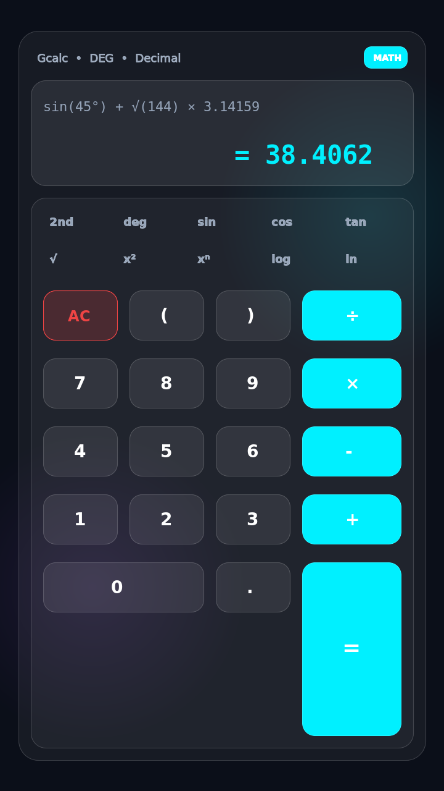
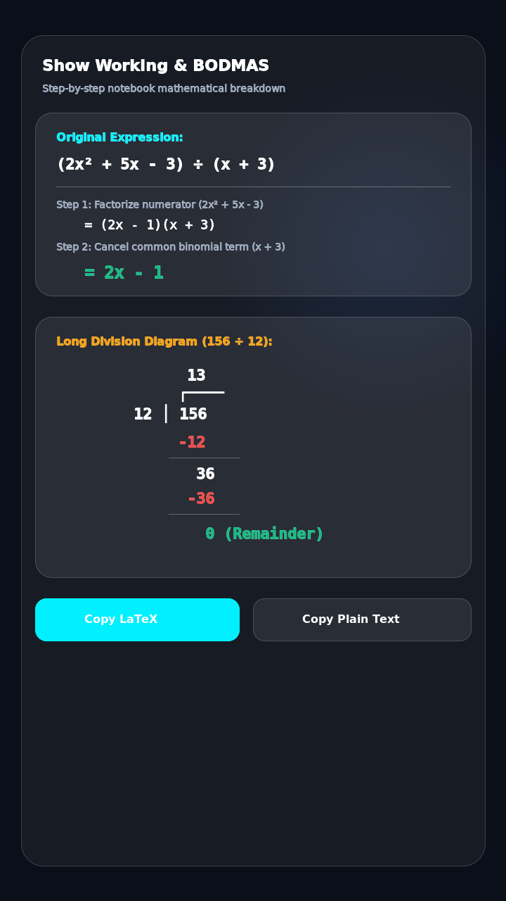
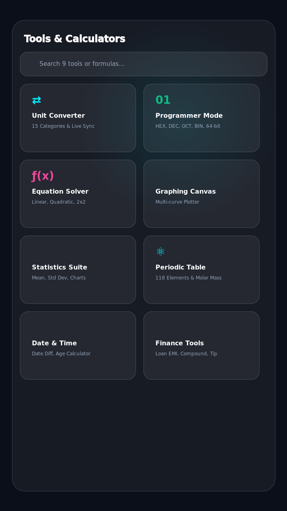
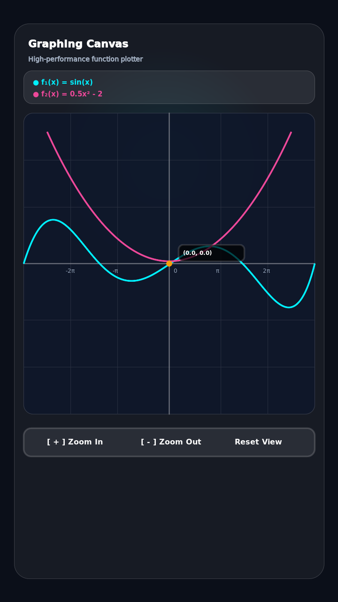
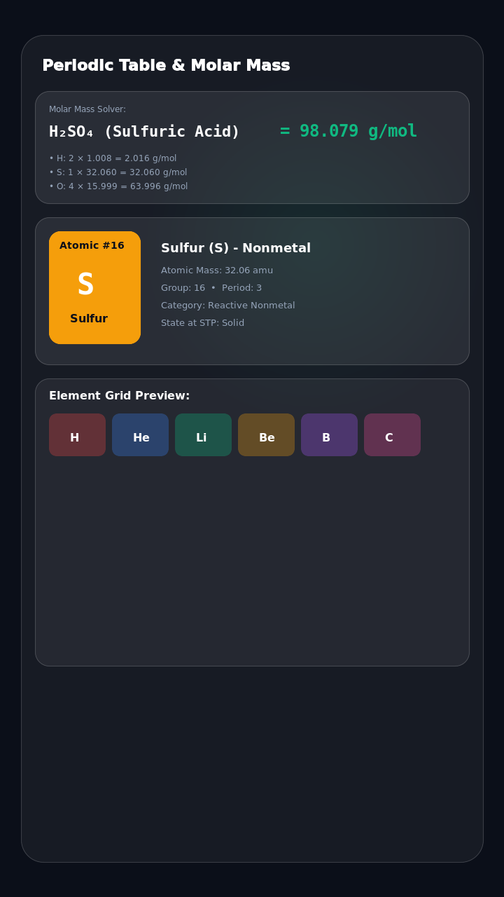
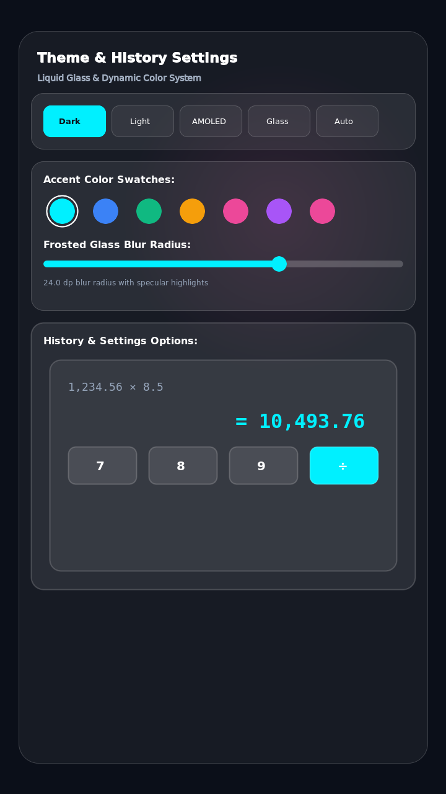

<p align="center">
  
</p>

<h1 align="center">Gcalc</h1>

<p align="center">
  <strong>A premium glass-morphic scientific and engineering calculator featuring notebook math notation, stacked fractions, and a comprehensive scientific tools suite.</strong>
</p>

<p align="center">
  <a href="https://github.com/krishkumarcodes/Gcalc/releases"></a>
  <a href="LICENSE"></a>
  
  
  
  <a href="CONTRIBUTING.md"></a>
</p>

<p align="center">
  <a href="https://github.com/krishkumarcodes/Gcalc/releases/latest">
    
  </a>
</p>

---

## 📸 Screenshots

| Standard Calculator | Working Window (Stacked Fractions) | Tools Hub |
|:---:|:---:|:---:|
|  |  |  |

| Graphing Canvas | Periodic Table | History & Settings |
|:---:|:---:|:---:|
|  |  |  |

---

## ✨ Features

- **Core Scientific Engine**:
  - Full angle mode support with live recalculation: DEG, RAD, GRAD.
  - Multi-format number representations: Decimal, Fraction (exact fractions e.g. `0.75 = 3/4`), Scientific, and Engineering notation.
  - 100-step Undo / Redo stack with tactile feedback.
  - Expandable scientific drawer: Trigonometry, Inverse Trig, Hyperbolics, Powers & Roots, Logarithms, Constants, and Memory (`M+`, `M-`, `MR`, `MC`, `STO`, `RCL`).
  - Friendly error states with instant key-press recovery.

- **Notebook-Style "Show Working"**:
  - Handwritten math rendering: divisions automatically formatted as genuine stacked fractions with centered operational baselines.
  - Full step-by-step BODMAS breakdowns.
  - Long-division bracket diagram mode for number ÷ number operations.
  - Copy solutions as Plain Text or LaTeX.

- **History Management**:
  - Categorized glass cards grouped by date (Today, Yesterday, previous dates).
  - Tap card to resume calculation in main display; tap result to insert as `Ans`.
  - Star favorites, search history, and swipe gestures to delete or star.

- **Design & Liquid Glass Theme**:
  - Apple-inspired frosted glass aesthetic with multi-layer blur, subtle specular highlights, and ambient light blobs.
  - 5 Built-in Themes: Dark, Light, AMOLED, Auto, and Glass.
  - 24+ Material Accent Color swatches plus a full Custom HSL picker with live mini-calculator preview.
  - Configurable thousands separators (Comma, Indian, Space, Period).
  - Left-handed mode & Wide zero key.

- **Complete Engineering & Scientific Tools Suite**:
  - **Unit Converter**: 15 categories (Length, Mass, Temperature, Speed, Volume, Energy, Pressure, Power, etc.) with dual-card live sync and custom numpad.
  - **Programmer Mode**: HEX, DEC, OCT, and BIN representations with interactive 64-bit toggle matrix, bitwise operations, ASCII preview, and IEEE-754 float breakdown.
  - **Equation Solver**: Linear, Quadratic, Cubic, 2×2 / 3×3 Systems, and Newton-Raphson numeric root-finding with step breakdown.
  - **Graphing Canvas**: High-performance plotter supporting up to 6 simultaneous curves, pinch-to-zoom, pan, coordinate tracing, and asymptote detection.
  - **Statistics Suite**: Statistical metrics (mean, median, mode, sample/population std dev, variance, quartiles) and interactive bar charts.
  - **Periodic Table & Molar Mass**: 118 elements with dual-axis panning, category highlights, full element inspector, and recursive chemical formula molar mass solver.
  - **Date & Time Suite**: Difference between dates, Add/Subtract offset calculator, and Exact Age breakdown with calendar picker.
  - **Finance Tools**: Loan EMI with amortization table, compound interest with frequencies, tip split, and discount calculator.
  - **Physical Constants**: Searchable reference library with in-place card expansion, descriptions, and one-tap clipboard copy.
  - **Comprehensive Formulas**: Physics, Chemistry, Computer Science, and Mathematics formulas with variable solving.

- **Data Privacy & Backup**:
  - Completely offline; no remote telemetry or cloud dependencies required.
  - Full JSON data backup export and import with conflict resolution (Merge / Replace).

---

## 🛠 Tech Stack

- **Runtime**: Android 7.0+ (API 24+) / Cross-platform PWA
- **Language**: Kotlin 2.0+
- **UI Framework**: Jetpack Compose (Material Design 3)
- **Architecture**: MVVM + Clean Architecture with Kotlin Coroutines & StateFlow
- **Typography**: Space Grotesk, Inter, JetBrains Mono
- **Build System**: Gradle Kotlin DSL (`build.gradle.kts`)

---

## 🚀 Getting Started

### Prerequisites
- JDK 17 or JDK 21 (Temurin / OpenJDK)
- Android SDK 34+
- Gradle 8.5+

### Installation & Build

```bash
# Clone the repository
git clone https://github.com/krishkumarcodes/Gcalc.git
cd Gcalc

# Build Debug APK
gradle :app:assembleDebug

# Run Unit Tests
gradle :app:testDebugUnitTest

# Install on connected device or emulator
gradle :app:installDebug
```

---

## 📱 Project Structure

```
gcalc/
├── app/
│   ├── src/
│   │   ├── main/
│   │   │   ├── java/com/example/
│   │   │   │   ├── components/     # Glass cards, numpad, logo, buttons
│   │   │   │   ├── engine/         # MathEngine, UnitConverterEngine, StepWorking
│   │   │   │   ├── formulas/       # FormulaRepository, 118 elements, constants
│   │   │   │   ├── screens/        # Calculator, Tools, History, Settings
│   │   │   │   │   └── tools/      # Individual engineering tool implementations
│   │   │   │   ├── store/          # SettingsStore, ThemeEngine, History
│   │   │   │   └── ui/theme/       # GlassTheme, Colors, Typography
│   │   │   └── res/                # Drawables, mipmaps, vector icons
│   │   └── test/                   # Unit & Robolectric test suite
│   └── build.gradle.kts
├── docs/                           # Architecture docs & screenshots
├── public/                         # App icons, SVG logos, assets
├── LICENSE                         # MIT License
├── README.md
├── CHANGELOG.md
└── CONTRIBUTING.md
```

---

## 🧪 Testing

To run the full suite of unit and logic tests:

```bash
gradle :app:testDebugUnitTest
```

---

## 🗺 Roadmap

- [ ] Matrix operations suite (multiplication, inversion, eigenvalues).
- [ ] Complex number graphing on Argand plane.
- [ ] Export step-by-step working directly as PDF notebook sheets.

---

## 🤝 Contributing

Contributions, issues, and feature requests are welcome! Please check out [CONTRIBUTING.md](CONTRIBUTING.md) before submitting a Pull Request.

---

## 📄 License

Distributed under the MIT License. See [LICENSE](LICENSE) for more details.

---

<p align="center">
  <strong>Created with precision by <a href="https://github.com/krishkumarcodes">Krish Kumar</a> (KRCODES)</strong>
</p>
